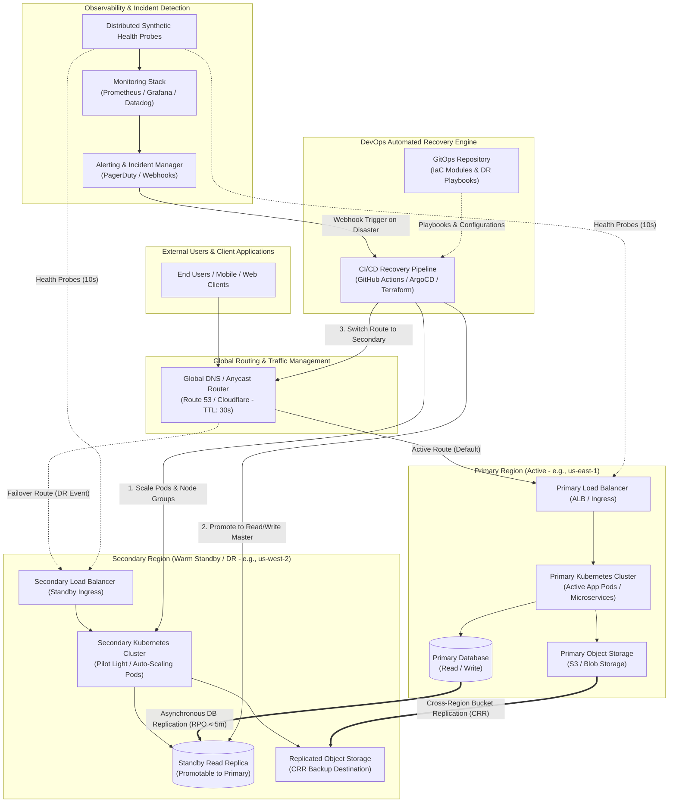
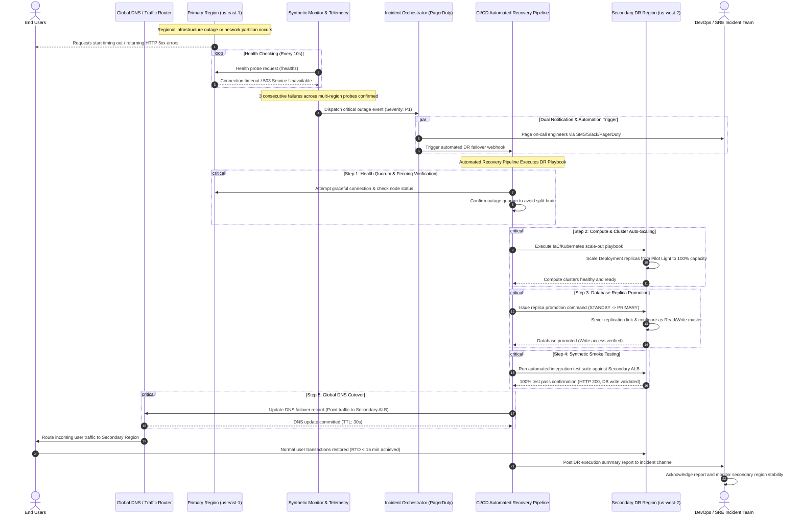

# DevOps-Based Disaster Recovery System — Architecture Specification

## Document Overview
This document specifies the end-to-end architecture, technical requirements, components, and automated operational workflows for the **DevOps-Based Disaster Recovery (DR) System** to resolve **Issue #1**. 

The system provides automated failover, cross-region replication, continuous health telemetry, and self-healing deployment pipelines to maintain high availability and business continuity in the event of regional cloud outages, infrastructure failures, or disaster events.

---

## 1. Project Requirements

### 1.1 Recovery Time Objective (RTO)
* **Target: RTO < 15 minutes**
* **Definition:** The maximum acceptable duration of infrastructure downtime and service disruption from outage detection to full operational recovery in the secondary region.
* **Service Tier Breakdown:**
  * **Tier 1 (Critical User APIs & Authentication):** RTO ≤ 5 minutes (automated warm standby failover).
  * **Tier 2 (Core Business Logic & Web Frontends):** RTO ≤ 10 minutes (container fleet auto-scaling).
  * **Tier 3 (Batch Jobs & Background Tasks):** RTO ≤ 15 minutes (delayed spool-up to prioritize core capacity).

### 1.2 Recovery Point Objective (RPO)
* **Target: RPO < 5 minutes**
* **Definition:** The maximum acceptable age of data that may be lost during an outage.
* **Implementation:**
  * Sub-second to near real-time asynchronous database replication across primary and secondary regions.
  * Continuous Write-Ahead Log (WAL) streaming and log shipping every 60 seconds.
  * Real-time multi-region bucket synchronization for user uploads and object storage.

### 1.3 High Availability (HA) Target
* **Availability SLA:** 99.99% ("Four Nines" uptime, allowing less than 52.6 minutes of unscheduled downtime per year).
* **Multi-AZ Resilience:** Within each cloud region, application workloads and database nodes span at least 3 distinct Availability Zones (AZs).
* **Cross-Region Redundancy:** Active-Passive (Warm Standby / Pilot Light) architecture distributed between two geographically separated cloud regions (e.g., Primary: `us-east-1`, Secondary DR: `us-west-2`).

### 1.4 Backup Cadence & Retention Matrix

| Backup Type | Frequency | Snapshot Method | Retention Period | Target Storage Class |
| :--- | :--- | :--- | :--- | :--- |
| **Transaction Logs (WAL)** | Continuous (Streaming / 5 min chunks) | Incremental log shipping | 7 days | Hot Geo-Replicated Object Storage |
| **Incremental Snapshots** | Every 1 hour | Differential block-level volume snapshots | 14 days | Multi-AZ Standard Cloud Storage |
| **Full Database Dumps** | Daily (02:00 UTC) | Managed DB point-in-time image with metadata | 30 days | Geo-Redundant Encrypted Bucket |
| **Immutable Weekly Archival** | Weekly (Sunday 04:00 UTC) | Air-gapped WORM (Write Once, Read Many) export | 90 days | Object Lock / Vault Storage |
| **Monthly Compliance Backup** | Monthly (1st of month) | Consolidated archive with cryptographic checksum | 1 to 7 years | Cold Archive / Deep Glacier tier |

* **Automated Restore Validation:** A recurring scheduled CI/CD job spins up an isolated sandbox environment every week, restores the latest backup image, executes synthetic data integrity checks, and reports verification status to ensure backups are not corrupted.

---

## 2. Core Project Components

### 2.1 Multi-Region Infrastructure (Primary & Secondary Regions)
* **Primary Region (Active Production):**
  * Hosts 100% of live user traffic during normal operations.
  * Application tier runs on elastic Kubernetes (EKS/GKE) worker nodes across 3 Availability Zones.
  * Hosts the primary read/write database cluster with auto-scaling read replicas.
* **Secondary Region (Warm Standby / Disaster Recovery):**
  * Standby infrastructure provisioned identically via Infrastructure as Code (IaC).
  * Runs a baseline "Pilot Light / Warm Standby" footprint: minimal compute instances, pre-pulled container images, active cross-region database read replica, and replicated storage.
  * Horizontally scales up to full production capacity within minutes upon activation signal from the recovery pipeline.

### 2.2 Global DNS & Load Balancer Failover
* **Global Anycast DNS Routing:**
  * Managed DNS (e.g., AWS Route 53, Cloudflare, or Azure Traffic Manager) configured with health-checked Failover / Weighted Routing policies.
  * Low Time-to-Live (TTL = 30 seconds) on public endpoint records to facilitate rapid propagation of DNS route changes.
* **Application Load Balancers (ALBs / Ingress Controllers):**
  * Regional reverse proxies handling TLS termination, path routing, and edge rate-limiting.
  * Ingress routes health status endpoints (`/healthz`, `/readyz`, `/livez`) queried by external probe agents every 10 seconds.

### 2.3 Database Replication & Storage Synchronization
* **Asynchronous Multi-Region Data Streaming:**
  * Primary database executes read/write transactions and asynchronously streams replication packets to the secondary region read replica.
  * Automated Promotion Protocol: Promotes the secondary read replica to standalone primary status upon disaster declaration, preventing split-brain scenarios via fencing tokens.
* **Object & Asset Storage Replication:**
  * Cross-Region Replication (CRR) enabled on object storage buckets with server-side KMS encryption.
  * Asynchronous versioned bucket mirroring guarantees static assets, attachments, and configuration files are consistently available in the DR region.

### 2.4 CI/CD Automated Recovery Pipeline
* **GitOps & Infrastructure as Code (IaC):**
  * Entire cloud footprint defined in declarative Terraform / OpenTofu modules and stored in version-controlled repositories.
  * Environment parity guaranteed through immutable container builds and centralized Helm / Kustomize templates.
* **Automated Recovery Orchestrator:**
  * CI/CD pipelines (GitHub Actions / GitLab CI / ArgoCD) paired with event-driven automation controllers.
  * Pipeline executes automated DR playbooks: scales up secondary compute clusters, triggers database promotion, verifies database write locks, conducts smoke tests, and alters DNS routing records.
* **Controlled Failback Pipeline:**
  * Reverse data synchronization playbook to copy delta writes back to the recovered primary region before gracefully swinging user traffic back.

### 2.5 Health Monitoring, Telemetry & Incident Alerting
* **Synthetics & Probes:**
  * Multi-point external synthetic monitoring probes query public endpoints across worldwide regions at 10-second intervals.
* **Telemetry Stack:**
  * Prometheus and OpenTelemetry collectors capture infrastructure metrics (CPU, memory, disk I/O), network latency, and application error rates (HTTP 5xx spikes).
  * Grafana dashboards provide a unified view of both regions' health and replication lag.
* **Automated Alerting & Incident Trigger:**
  * Metric thresholds breach triggers high-priority alerts via PagerDuty / Opsgenie.
  * Webhook dispatchers trigger the automated recovery pipeline when failure criteria are met (e.g., 3 consecutive health probe failures across >66% of monitoring locations, plus DB heartbeat loss).

---

## 3. System Architecture Diagram

The diagram below illustrates the end-to-end multi-region topology, data synchronization channels, telemetry probes, and CI/CD automated recovery control plane.

---

## 4. Disaster Recovery Automated Failover Workflow Diagram

The workflow diagram below details the autonomous execution sequence followed by the system upon detecting a critical regional outage, from fault detection to DNS cutover and notification.

---

## 5. Failback & Post-Incident Synchronization Strategy

Once the root cause in the primary region has been resolved and certified operational:
1. **Re-establish Reverse Replication:** Configure the primary region database as a replica of the secondary region database to ingest all transaction updates written during the disaster window.
2. **Delta Verification:** Monitor replication lag until delta drops to zero (consistent state achieved).
3. **Scheduled Maintenance Window Cutover:**
   * Place application in brief read-only maintenance mode (≤ 60 seconds).
   * Repoint DNS records back to Primary Region ALB.
   * Promote Primary DB back to primary read/write status.
   * Revert Secondary DB back to read-replica mode.
   * Scale secondary compute tier down to warm standby footprint.
4. **Post-Mortem & Incident Logging:** Automated generation of timestamped audit logs for compliance, RTO/RPO calculation, and root-cause analysis.
